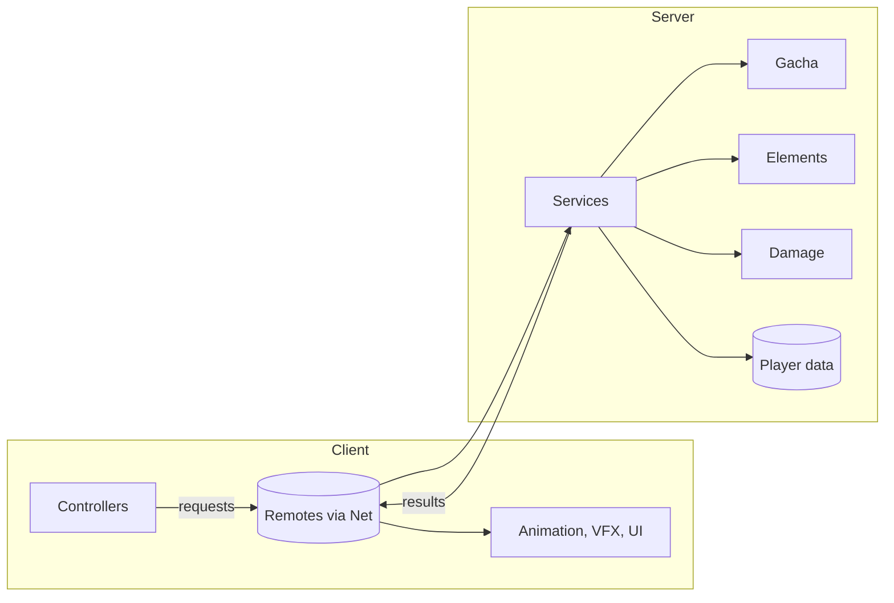

# Systems

The technical design of Farborn, by Owl On The Moon Studios. Each page explains what a system
does, how it works and where its code lives. "Built" means the code is in this repository and
covered by tests; "Designed" means the design is set and the code is next on the roadmap.

| System | Code | Tests | Status |
| --- | --- | --- | --- |
| [Service framework](framework.md) | `src/server/init.server.luau`, `src/client/init.client.luau` | Studio | Built |
| [Networking](networking.md) | `src/shared/Net.luau` | Studio | Built |
| [Player data](player-data.md) | `src/server/Services/PlayerDataService.luau` | Studio | Built (starter) |
| [Wish system](wish-system.md) | `src/shared/Gacha.luau`, `src/server/Services/GachaService.luau` | `tests/Gacha.spec.luau` | Built |
| [Elemental reactions](elemental-reactions.md) | `src/shared/Elements.luau`, `src/shared/Config/ElementConfig.luau` | `tests/Elements.spec.luau` | Built |
| [Damage model](damage-model.md) | `src/shared/Damage.luau` | `tests/Damage.spec.luau` | Built |
| [Planned systems](planned.md) | Combat, party, movement, enemy AI, world, progression, quests, co-op, UI, anti-exploit | | Designed |

## How the pieces fit

The client asks and plays the feedback; the server checks every request and decides the outcome.
Everything in the middle column (Gacha, Elements, Damage) is pure Luau with no Roblox APIs, which
is what lets it run in the unit tests.
