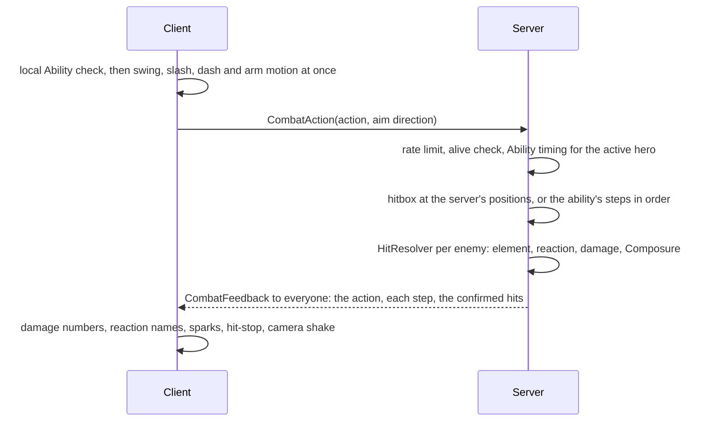

# Combat

**Status:** built and tested · **Code:** `src/server/Services/CombatService.luau`,
`src/server/Combat/HitResolver.luau`, `src/server/Combat/AbilityRunner.luau`,
`src/shared/Combat/Ability.luau`, `src/shared/Combat/Defense.luau`, `src/shared/Config/Heroes.luau`,
`src/client/Controllers/CombatController.luau`, `src/client/Effects.luau`,
`src/client/Controllers/HudController.luau`, `src/client/TouchLayout.luau` · **Tests:** `tests/Ability.spec.luau`,
`tests/Defense.spec.luau`, `tests/TouchLayout.spec.luau`

## The loop

1. **Open** with a Relay: swap in a hero who has rested on the bench.
2. **Build** with basic attacks and Techniques, applying elements and filling elites' Composure.
3. **Defend** with dodges, Slips and Lifts; each successful one returns Finale energy.
4. **Break** the Composure bar: the enemy is Rattled for 6 seconds, takes 30% more damage, and
   heroes with a ready Relay can Pile-On.
5. **Cash out** with Finales during the Rattled window, then swap and repeat.

## Feel first, truth on the server

The client plays its own swing the moment its local copy of `Ability` accepts the input, so
attacks never wait on the network. Damage numbers, reactions and hit-stop wait for the server's
confirmed hits, so what players see is always what happened. Other players see the same swing
from the feedback message.

The client only sends **which action** and **which way it is aiming**. The server decides the
timing, the hitbox, every number and every effect.

## Hero kits

Every number lives in `Config/Heroes.luau`, one table per hero, following the character
framework:

| Part | Rule | Typical numbers |
| --- | --- | --- |
| Basic Attack | A 4 or 5 hit chain set by the weapon; hold to charge; attack while gliding or falling to plunge | The chain finishes in 2.5 to 3.5 s |
| Technique | The hero's skill | 6 to 15 s cooldown; Finale energy per enemy hit, capped per cast |
| Finale | The ultimate; freezes nearby enemies for its short opening | 60 to 90 energy; benched heroes gain 40% of what the active hero earns |
| Relay | Fires when the hero swaps in after at least 6 s on the bench | The portrait glows gold when it's ready |

Focus users' basic attacks carry their element; other weapons hit physically unless a Relay
infused them, and rely on Techniques and Finales for elements.

Techniques, Finales and Relays are lists of **steps** that `AbilityRunner` plays in order, so a
new kit is data, not code:

| Step | What it does |
| --- | --- |
| `hit` | An area hit: a circle ahead of the hero, or an arc in front |
| `line` | A hit along a straight line (dashes) |
| `dash` | The hero dashes forward; later steps start where it ends |
| `pull` | Drags small enemies towards a point |
| `rain` | A run of small hits falling at random points in an area |
| `zone` | A lasting area that hits enemies or heals whoever stands in it |
| `heal`, `shield` | Heals or shields the active hero, the incoming hero or the whole party |
| `effect` | Slows enemies in an area, or marks the nearest to take more critical damage |
| `infuse` | Gives a hero's next few basic attacks an element |

The prototype ships four kits, one for each member of the free team every player owns: an Astral
sword user, a Tide lance healer, a Frost Focus debuffer and a Flame greatsword hammer. Between
them they make Starburst, Scald, Thaw and Lock.

## Defence

| Action | Input | Window | Reward |
| --- | --- | --- | --- |
| Dodge | Dodge button | Brief invulnerability; 3 dodges before a short cooldown | Safety |
| Slip | Dodge just before a hit lands | 0.2 s (0.3 s on Assist) | Nearby enemies slow for 1 s; the next attack is a Slip counter (1.5×, Composure); Finale energy |
| Lift | Attack as a gold-flash attack lands | 0.15 s (0.25 s on Assist) | Interrupts the attack, big Composure damage, Finale energy |
| Cover | Swap during the Slip slow-down | 1.2 s after a Slip | The incoming hero swaps in at once and counters with their Relay |

The server judges these on its own clock, which sees a player's input late by about half their
ping while the player reacted to an enemy they saw late by the other half. So every enemy strike
is decided a moment after it lands (a 0.12 s allowance), and an input still in flight counts.
`Shared.Combat.Defense` holds the rules, and its tests cover each window.

## Hits

For each enemy hit, `HitResolver`:

1. Applies the element through `Elements.apply` (basic attacks once every 2.5 s per enemy).
2. Runs the reaction: Scald and Thaw multiply the hit, Flashpoint explodes, Conduct chains,
   Lock freezes, Brittle weakens, Sweep spreads, Geode leaves a crystal, Starburst blasts.
3. Rolls damage with `Damage.computeHit`, with Brittle, Sweep, Marked and Rattled applied.
4. Shatters Lock on heavy hits, fills Composure (heavy hits, reactions, Relays, Slip counters),
   and lights Burning when Flame stays on the enemy.

## Feedback

All effects are built from parts and UI at runtime, so the slice needs no uploaded assets.

| Effect | When |
| --- | --- |
| Arm swing layered on the current animation, slash arc or flying orb | Every basic and charged attack |
| Ground rings, light columns, streaks, gravity wells, falling stars and lasting zones in the element's colour | Technique, Finale and Relay steps |
| Damage numbers coloured by element, larger with `!` on crits; green numbers for heals | Every confirmed hit and heal |
| The reaction's name in one big word | Every reaction |
| Hit-stop (animations pause for 0.06 s, 0.1 s on heavy hits) and camera shake | When your own hits land |
| "SLIP!" with a moment of grey slow motion, "LIFT!", "COVER!", "PILE-ON!", "RATTLED!", "COUNTER!" | The defensive layer and Composure |

## HUD

- Party list with element and HP per hero; a gold glow when that hero's Relay is ready. Tap or
  click to swap.
- HP bar with shield overlay, a Grip bar that shows only while Grip is spent, and dodge pips.
- Technique button with its cooldown and Finale button that fills with energy and glows when ready.
- Above each enemy: health, the status icon, a Composure bar on elites and the attack glint.
- Touch: attack, dodge (hold to sprint) and lock-on buttons. `TouchLayout` places them, with
  Technique and Finale, around Roblox's jump button and clear of the thumbstick, and grows them on
  tablets, where the jump button is bigger. Held buttons let go when the finger lifts, even if it
  slid off the button first. The layout follows the last input used, so keyboard, gamepad and
  touch can be mixed on one device.

## Controls

| Action | Keyboard and mouse | Gamepad | Touch |
| --- | --- | --- | --- |
| Attack (hold to charge) | Left click | X | Attack |
| Technique | E | R1 | Technique button |
| Finale | Q | Y | Finale button |
| Dodge, hold to sprint | Left Shift or right click | B | Dodge |
| Jump, glide in the air | Space | A | Jump |
| Swap hero, Cover, Pile-On | 1-4 | D-pad | Party list |
| Lock on | T or middle click | R3 | Lock |
| Free the cursor | Hold Left Alt | | |

## Names and content

Hero and enemy ids in this repository are placeholders, and so are the names in `Config`. The
real names of unannounced characters live only in the game's place file, in a ModuleScript at
`ReplicatedStorage.PrivateContent` that is not part of the repository. `Shared.Content` shows
those names when the module is there and the placeholders when it isn't. The main character
always shows the player's own display name.
