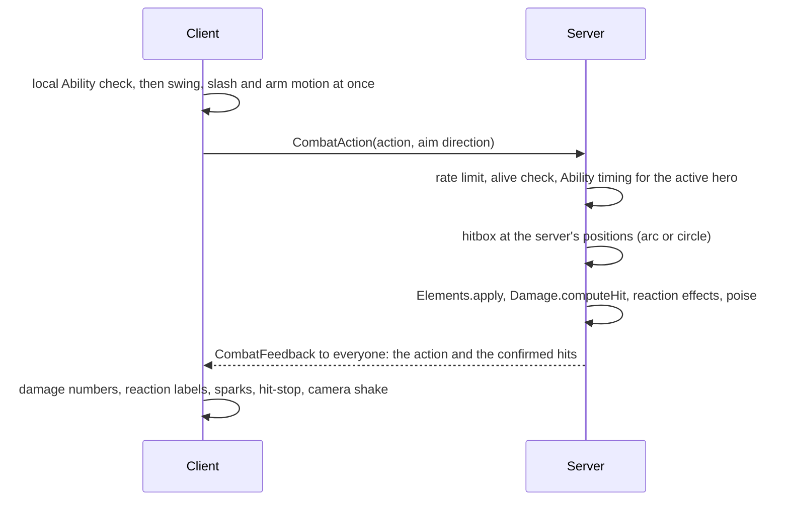

# Combat

**Status:** built and tested · **Code:** `src/server/Services/CombatService.luau`,
`src/shared/Combat/Ability.luau`, `src/shared/Config/Heroes.luau`,
`src/client/Controllers/CombatController.luau`, `src/client/Effects.luau`,
`src/client/Controllers/HudController.luau` · **Tests:** `tests/Ability.spec.luau`

## Feel first, truth on the server

The client plays its own swing the moment its local copy of `Ability` accepts the input, so
attacks never wait on the network. Damage numbers, reactions and hit-stop wait for the server's
confirmed hits, so what players see is always what happened. Other players see the same swing
from the feedback message.

The client only sends **which action** and **which way it is aiming**. The server decides the
timing, the hitbox, every number and every effect.

## Hero kits

Every number lives in `Config/Heroes.luau`, one table per hero:

| Part | What it is |
| --- | --- |
| Chain | Four normal attacks, each with its own multiplier, reach, arc, recovery and poise damage. The last hit is heavy. |
| Skill | An elemental area attack on a cooldown that generates burst energy per enemy hit. |
| Burst | A big elemental area attack that needs full energy, with its own cooldown. |
| Stats | HP, attack, defense level, crit rate and crit damage. |

Catalyst users' normal attacks carry their element; other weapons hit physically and rely on the
skill and burst for elements. The combat slice ships four placeholder heroes (Fire sword, Water
catalyst, Lightning polearm, Ice claymore), so swapping between them triggers Steam, Melt,
Overload, Conduct, Freeze and Brittle from the [reaction table](elemental-reactions.md).

Still to come: charged and plunging attacks, and animation assets to replace the procedural
swings.

## Timing (`Shared.Combat.Ability`)

- The chain advances one hit per accepted attack and resets after 1.1 s without one.
- Every action sets a recovery time; nothing else is accepted until it ends.
- The skill and burst have cooldowns; the burst also needs energy equal to its cost.
- The server accepts requests up to 0.12 s early to absorb network jitter, and no earlier.
- Swapping out cancels the outgoing hero's recovery, so a swap can cut a combo short.

## Hits

| Action | Hitbox | Element |
| --- | --- | --- |
| Chain hit | Arc in front of the hero (`range`, `arc`) | The hero's, for catalyst users |
| Skill | Circle `forward` studs ahead (`radius`) | The hero's |
| Burst | Circle `forward` studs ahead (`radius`) | The hero's |

For each enemy hit the server:

1. Applies the element through `Elements.apply`, gated by the internal cooldown per source.
2. Rolls damage with `Damage.computeHit` (Brittle lowers defense, amplify reactions multiply).
3. Adds transform reaction damage, spreads Sweep auras to enemies nearby, and gives the hero an
   Earth shield worth 20% of max HP.
4. Deals poise damage, which can stagger the enemy (see [Enemy AI](enemy-ai.md)).

Energy: skills give `energyPerTarget` per enemy hit up to a cap; landed normal attacks give 1.
Heroes off the field receive 60%.

## Feedback

All effects are built from parts and UI at runtime, so the slice needs no uploaded assets.

| Effect | When |
| --- | --- |
| Arm swing layered on the current animation, slash arc or flying orb | Every chain hit |
| Ground ring and light column in the element's colour | Skills and bursts |
| Damage numbers coloured by element, larger with `!` on crits | Every confirmed hit |
| Reaction label (Steam, Freeze, ...) | Every reaction |
| Hit-stop (animations pause for 0.06 s, 0.11 s on heavy hits) and camera shake | When your own hits land |
| "Break!" | An enemy's poise breaks |
| "Evade" | An enemy strike lands inside your dodge |

## HUD

- Party list with element and HP per hero; tap or click to swap.
- HP bar with shield overlay, and a stamina bar that shows only while stamina is spent.
- Skill button with its cooldown and burst button that fills with energy and glows when ready.
- Enemy health bars with their current aura.
- Touch: attack, dodge (hold to sprint) and lock-on buttons, laid out around Roblox's thumbstick
  and jump button. The layout follows the last input used, so keyboard, gamepad and touch can be
  mixed on one device.

## Controls

| Action | Keyboard and mouse | Gamepad | Touch |
| --- | --- | --- | --- |
| Attack (hold to chain) | Left click | X | Attack |
| Skill | E | Y | Skill button |
| Burst | Q | R1 | Burst button |
| Dodge, hold to sprint | Left Shift | B | Dodge |
| Jump, glide in the air | Space | A | Jump |
| Swap hero | 1-4 | D-pad | Party list |
| Lock on | T or middle click | R3 | Lock |
| Free the cursor | Hold Left Alt | | |
