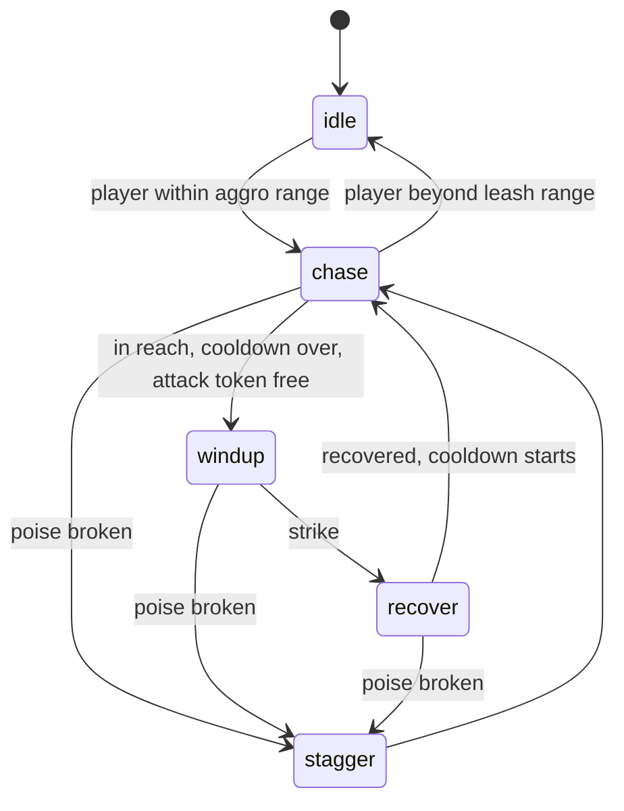

# Enemy AI

**Status:** built and tested · **Code:** `src/shared/Combat/EnemyBrain.luau`,
`src/server/Services/EnemyService.luau`, `src/shared/Config/Enemies.luau`
· **Tests:** `tests/EnemyBrain.spec.luau`

## The brain

Each enemy's decisions come from `EnemyBrain`, a pure state machine with no Roblox APIs. The
server feeds it the distance to the nearest player and whether it may attack, and acts on the
event it returns.



- **Telegraphs:** every wind-up shows a red disc on the ground that fills over the full wind-up,
  so a well-timed dodge always beats it.
- **Attack tokens:** only two enemies may wind up at once. The rest wait in a ring just out of
  reach and spread apart, so a group surrounds the player readably instead of piling on.
- **Poise:** hits deal poise damage; when it breaks, the enemy staggers (and is knocked back),
  cancelling any wind-up in progress. Poise then refills.
- **Freeze:** a frozen enemy is encased in ice and its timers pause until it thaws.

## The training grunt

| Stat | Value |
| --- | --- |
| HP | 1300 |
| Wind-up | 0.85 s |
| Strike | 8 studs, 130° arc |
| Cooldown between attacks | 2.4 s |
| Poise | 80, stagger 1.1 s |

All values are in `Config/Enemies.luau`. The body is built from parts at runtime; models replace
it when art is ready.

## Test arena

`ArenaService` builds a grey-box arena when the place has none: open floor, cover pillars, a cliff
to climb with a ramp beside it for gliding, a spawn pad and five enemy spawns. Defeated enemies
respawn after 6 seconds. Ten enemies run at 60 fps in Studio.

## Studio test commands

`DevService` adds `ServerStorage.DevCommands` in Studio only. Run these from the command bar
during a playtest:

```lua
local dev = game.ServerStorage.DevCommands
dev:Invoke("spawn", 5)   -- more grunts
dev:Invoke("enemies")    -- HP, aura, statuses and state of every enemy
dev:Invoke("party")      -- every hero's HP, shield and energy
dev:Invoke("energy")     -- fill every burst
dev:Invoke("hurt", 500)  -- damage the active hero (downed heroes, wipes)
dev:Invoke("restore")    -- heal every party
```
