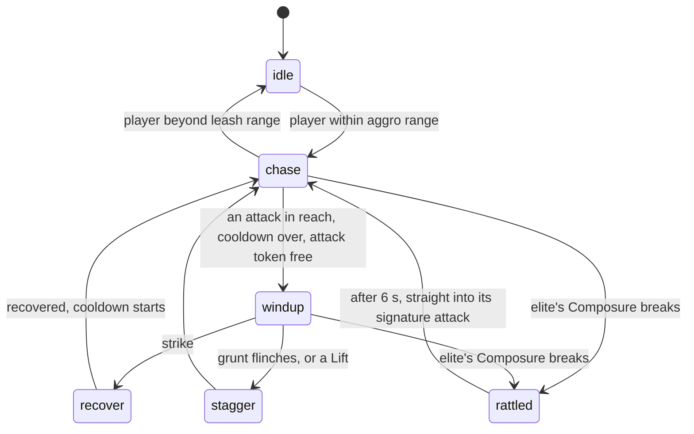

# Enemy AI

**Status:** built and tested · **Code:** `src/shared/Combat/EnemyBrain.luau`,
`src/server/Services/EnemyService.luau`, `src/shared/Config/Enemies.luau`
· **Tests:** `tests/EnemyBrain.spec.luau`, `tests/Defense.spec.luau`

## The brain

Each enemy's decisions come from `EnemyBrain`, a pure state machine with no Roblox APIs. The
server feeds it the distance to the nearest player and whether it may attack, and acts on the
event it returns.



- **Attacks:** each enemy has one or more attacks, each with its own reach, wind-up, cooldown and
  weight. The brain picks among the ones in reach.
- **Telegraphs:** every wind-up shows a glint above the enemy and the attack's shape on the
  ground for its full length. The glint says how to answer: a white ring is a normal attack, a
  gold star can be Lifted, a red burst can only be dodged.
- **Attack tokens:** only two enemies may wind up at once. The rest wait in a ring just out of
  reach and spread apart, so a group surrounds the player readably instead of piling on.
- **Grunts flinch** from every hit: poise breaks easily, which cancels any wind-up in progress.
- **Elites ignore poise** and fill a Composure bar instead. Heavy hits, reactions, Relays, Slip
  counters and Lifts fill it; when it breaks the elite is Rattled for 6 seconds, takes 30% more
  damage and can be Piled-On.
- **Freezes:** Lock (on enemies that can be frozen), a Finale's opening and a Slip's slow-down
  pause an enemy's timers until they end. Chilled and Slowed enemies walk slower.

## Strikes are decided a moment later

A strike is resolved 0.12 seconds after it lands, so a player's dodge or attack that is still
travelling to the server counts:

1. If the attack is gold and a player in reach attacked just before it landed, it is **Lifted**:
   no damage, the enemy is stunned for a second and takes big Composure damage.
2. A player who dodged in time **evades**. If the dodge came just before the hit, it is a
   **Slip**: nearby enemies slow for a second, the next attack becomes a Slip counter, and a swap
   in the next 1.2 seconds is a Cover.
3. Everyone else in reach takes the hit.

An enemy that is killed, stunned or Rattled between landing and decision never lands it.

## The training enemies

| | Training Grunt | Training Brute |
| --- | --- | --- |
| Tier | Grunt | Elite |
| HP | 420 | 6,000 |
| Defence | 400 | 500 |
| Attacks | Swipe (white) | Swipe (white), overhead (gold, Liftable), ground slam (red, dodge only) |
| Poise or Composure | Flinches from every hit | 260 Composure; slams as soon as a Rattled window ends |
| Time to defeat, solo | 2 to 4 seconds | 15 to 30 seconds |

All values are in `Config/Enemies.luau`. Bodies are built from parts at runtime; models replace
them when art is ready.

## Test arena

`ArenaService` builds a grey-box arena when the place has none: open floor, cover pillars, a cliff
to climb with a ramp beside it for gliding, a spawn pad, five grunt spawns and one elite spawn by
the cliff. A spawn marker's `Enemy` attribute picks what spawns there. Defeated enemies respawn
after a few seconds. Ten enemies run at 60 fps in Studio.

## Studio test commands

`DevService` adds `ServerStorage.DevCommands` in Studio only. Run these from the command bar
during a playtest:

```lua
local dev = game.ServerStorage.DevCommands
dev:Invoke("spawn", 5)                -- more grunts
dev:Invoke("spawn", 1, "elite_brute") -- or any enemy id
dev:Invoke("enemies")                 -- HP, status, effects, Composure and state of every enemy
dev:Invoke("party")                   -- every hero's HP, shield, energy and infusion
dev:Invoke("energy")                  -- fill every Finale
dev:Invoke("hurt", 500)               -- damage the active hero (downed heroes, wipes)
dev:Invoke("restore")                 -- heal every party
```
