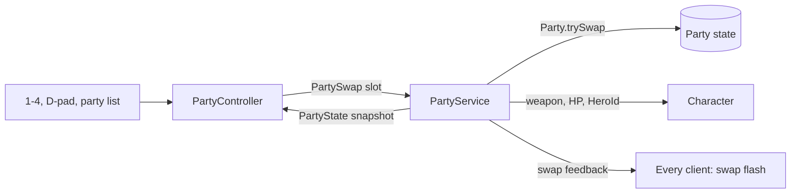

# Party and swap

**Status:** built and tested · **Code:** `src/shared/Combat/Party.luau`,
`src/server/Services/PartyService.luau`, `src/client/Controllers/PartyController.luau`
· **Tests:** `tests/Party.spec.luau`

## How it works

A party holds up to four heroes (`GameConfig.Party`). One is on the field; swapping is instant
and keeps the character's position, momentum and camera, because the same character switches
hero rather than being replaced.

- **Per-hero state:** HP, shield, cooldowns and burst energy are kept separately for every hero.
  The Humanoid always mirrors the active hero's HP.
- **Swap cooldown:** 1 second. The server refuses swaps inside it and always answers with a fresh
  party snapshot, so a refused swap corrects the client's prediction straight away.
- **Downed heroes:** a hero at 0 HP is down and cannot be swapped in. When the active hero goes
  down, the next one standing takes the field immediately.
- **Party wipe:** when nobody is standing the character is defeated, and the whole party is
  restored on respawn.
- **Visible hero:** each hero's weapon is attached to the character on the server, so every
  player sees who is fighting.

The client predicts swaps for instant feedback and keeps a local copy of each hero's `Ability`
state for the HUD; the server's snapshots overwrite cooldowns and energy whenever they arrive.

## Data flow

## Starter party

Until rosters are wired to player data, everyone fights with
`GameConfig.Party.StarterParty`: the four placeholder heroes in `Config/Heroes.luau`.
