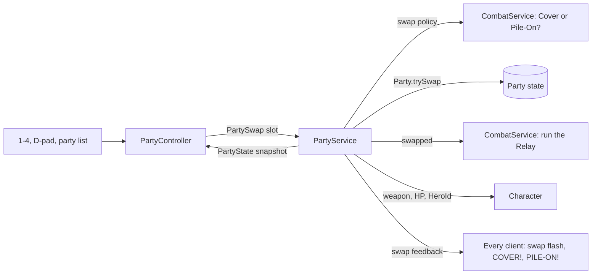

# Party and swap

**Status:** built and tested · **Code:** `src/shared/Combat/Party.luau`,
`src/server/Services/PartyService.luau`, `src/client/Controllers/PartyController.luau`
· **Tests:** `tests/Party.spec.luau`

## How it works

A party holds up to four heroes (`GameConfig.Party`). One is on the field; swapping is instant
and keeps the character's position, momentum and camera, because the same character switches
hero rather than being replaced.

- **Per-hero state:** HP, shields, cooldowns, Finale energy and infusions are kept separately for
  every hero. The Humanoid always mirrors the active hero's HP.
- **Swap cooldown:** 1 second. The server refuses swaps inside it and always answers with a fresh
  party snapshot, so a refused swap corrects the client straight away.
- **Relay:** a hero who has rested on the bench for at least 6 seconds fires their Relay when they
  swap in. Their portrait glows gold while it's ready.
- **Cover:** a swap within 1.2 seconds of a Slip ignores the cooldown, and the incoming hero
  counters with their Relay.
- **Pile-On:** while an enemy nearby is Rattled, swapping to a hero with a ready Relay ignores the
  cooldown, up to three times per Rattled window.
- **Shields:** a Geode crystal's shield absorbs 50% more of its own element.
- **Downed heroes:** a hero at 0 HP is down and cannot be swapped in. When the active hero goes
  down, the next one standing takes the field immediately.
- **Party wipe:** when nobody is standing the character is defeated, and the whole party is
  restored on respawn.
- **Visible hero:** each hero's weapon is attached to the character on the server, so every
  player sees who is fighting.

## Data flow

## Starter party

Until rosters are wired to player data, everyone fights with `GameConfig.Party.StarterParty`: the
free team in `Config/Heroes.luau`.
