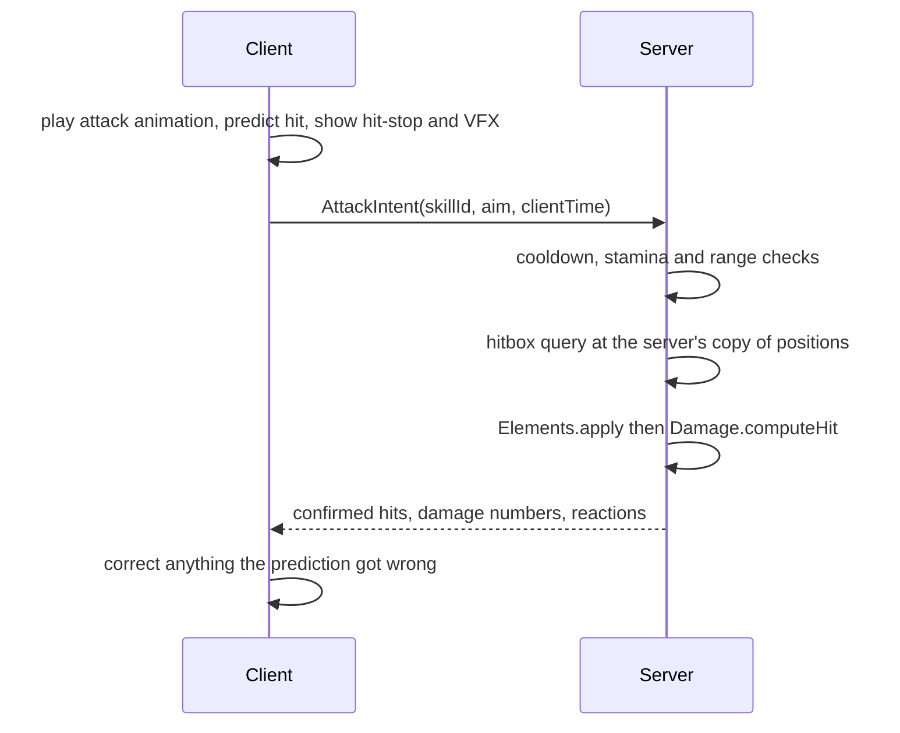

# Planned systems

**Status:** designed · Each section is the spec the code will follow. Milestones refer to
[ROADMAP.md](../../ROADMAP.md).

## Combat (M1)

- **Feel first, truth on the server.** The client plays the swing, hit-stop and VFX at once; the
  server confirms the hit with spatial queries and owns damage.
- **Kit per hero:** a 4-hit attack chain, a charged attack, a plunge, an elemental skill on a
  cooldown and a burst that charges from energy.
- **Hit-stop and poise:** short freezes on impact; enemies have poise that heavy hits break.

## Party and swap (M1)

Up to four heroes. Swapping is instant and keeps position and camera; HP, energy and cooldowns
are kept per hero. A swap cooldown stops spam. The server owns the active slot.

## Movement and stamina (M1)

Sprint, dodge with brief invulnerability, climb, glide and swim, all sharing one stamina bar.
The server tracks stamina from timestamps, so a modified client cannot fly or dodge forever.

## Enemy AI (M1)

A state machine per enemy: idle → alert → chase → wind-up → attack → recover, with stagger as
an interrupt. Wind-ups are always telegraphed so a well-timed dodge beats any attack. Groups
share an attack token so only one or two enemies swing at once.

## Character progression (M2)

Hero levels with ascension caps, three talents per hero, duplicate unlocks, a weapon slot and
gear sets. All curves are config tables, so balancing never needs code changes.

## World and exploration (M3)

- Roblox StreamingEnabled with each region as its own model, so phones only load what is near.
- Waypoints, chests, collectibles, puzzles, guardians hidden in the wild, and a world level that
  scales enemies as the player grows.
- One distinct rule per nation (for example, a day-night cycle that changes what is open).

## Quests and dialogue (M2)

Quests are data: steps, conditions and rewards in config, with dialogue by line id so text can
be translated. The server tracks progress; the client shows the tracker and cutscenes.

## Co-op (M3)

Up to four players in one world. The host's world state is used; each player keeps their own
progress and loot. Combat and reactions work the same with mixed parties.

## UI (M1 onward)

One controller per screen, with shared components (buttons, tooltips, item cards) and
layouts that work on phone, PC and console.

## Anti-exploit (all milestones)

- Every remote validates argument types and ranges.
- Rate limits per player on every request.
- The server owns all outcomes: currency, drops, wishes, damage, cooldowns and quest progress.
- Suspicious values are logged for review instead of silently ignored.
