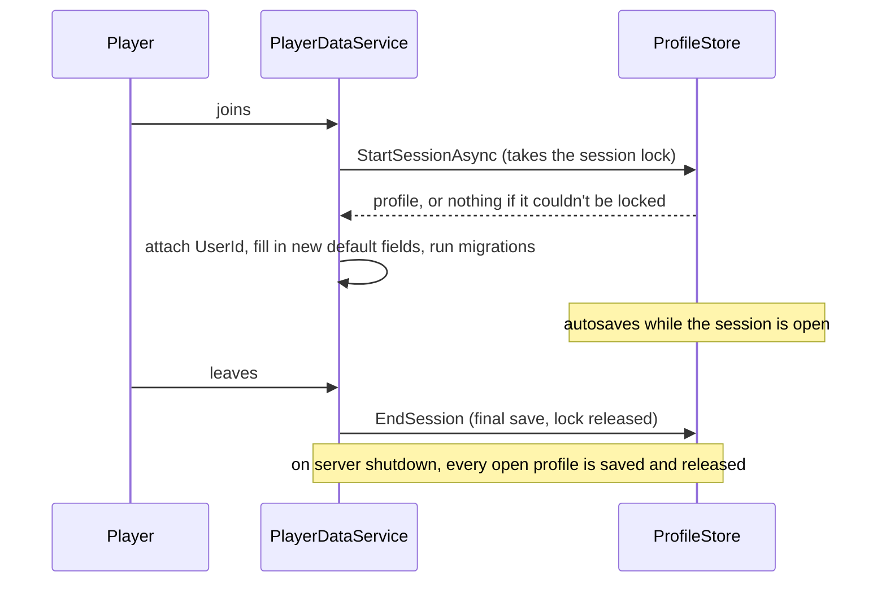

# Player data

**Status:** built and tested · **Code:** `src/server/Services/PlayerDataService.luau`,
`src/server/Data/Migrations.luau` · **Tests:** `tests/Migrations.spec.luau`

## How it works

Saves use [ProfileStore](https://github.com/MadStudioRoblox/ProfileStore) (installed with Wally),
which session-locks every profile: a profile is open on one server at a time.

- **No duplication or rollbacks:** a player who hops servers quickly can't have their save open
  twice. If another server takes the session, this one lets go and asks the player to rejoin.
- **Reconcile:** new fields added to `GameConfig.DefaultProfile` appear in old saves
  automatically.
- **Migrations:** `GameConfig.DataVersion` is stored with every profile. When the data shape
  changes, bump it and add a step to `Data/Migrations.luau`; old saves are upgraded one version
  at a time when they load. The tests cover renames, moves and saves from newer builds.
- **Data requests:** each profile is linked to its player's UserId, as Roblox requires for
  data deletion requests.
- **Separate currencies:** earned and bought currency are kept apart so the wish system can
  follow regional rules.
- **Fallback:** without API access (a new Studio place) or without the package installed, the
  service uses temporary profiles and says so in the output, so play-testing never blocks.

Other services only use `PlayerDataService.get(player)` and `PlayerDataService.waitFor(player)`,
which return the live data table; changes to it are saved.
