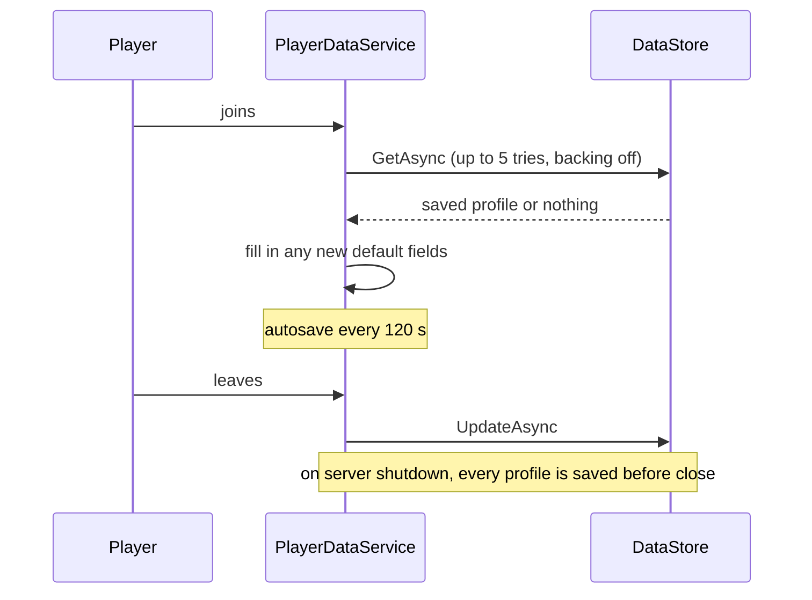

# Player data

**Status:** built (starter) · **Code:** `src/server/Services/PlayerDataService.luau`

## How it works

- **Reconcile:** new fields added to `GameConfig.DefaultProfile` appear in old saves
  automatically.
- **Retries:** every DataStore call retries with exponential backoff; if loading still fails,
  the player is asked to rejoin instead of being given an empty save that could overwrite theirs.
- **Versioned:** `GameConfig.DataVersion` is stored with every profile for future migrations.
- **Separate currencies:** earned and bought currency are kept apart so the wish system can
  follow regional rules.

## Next step

Before the closed alpha, storage moves to ProfileStore for session locking, so a player who
hops servers quickly can never duplicate or roll back items. `get` and `waitFor` keep the same
API, so no other system changes.
