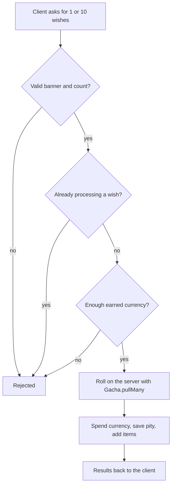

# Wish system

**Status:** built and tested · **Code:** `src/shared/Gacha.luau`, `src/server/Services/GachaService.luau`,
`src/shared/Config/Banners.luau` · **Tests:** `tests/Gacha.spec.luau`

## Rules

| Rule | Default |
| --- | --- |
| 5-star base rate | 0.6% |
| 4-star base rate | 5.1% |
| Soft pity | From pull 74, the 5-star rate rises 6% per pull |
| Hard pity | A 5-star is guaranteed by pull 90; a 4-star or better by pull 10 |
| Featured 50/50 | A 5-star has a 50% chance to be the featured hero; losing guarantees the next one |
| Long-run 5-star rate | About 1.6% (checked by a 100,000-pull test) |

All numbers are data in `Banners.luau`, and every banner is validated when it loads.

## How a wish works

- **Pure core.** `Gacha.pull` takes a banner, a pity state and a random function, and returns a
  result and a new state without changing its input. That makes it fully testable with seeded
  random numbers.
- **Server only.** The client never rolls. A per-player lock stops double requests.
- **Published odds.** `GetBannerOdds` serves the exact numbers the roller uses, so the shop
  never shows hand-typed odds.
- **Regional rules.** Roblox's PolicyService says where paid random items are restricted.
  `GachaService.canUsePaidRandomItems` checks it and fails safe (treats an error as restricted).
  Wishes currently spend only currency earned in game.
